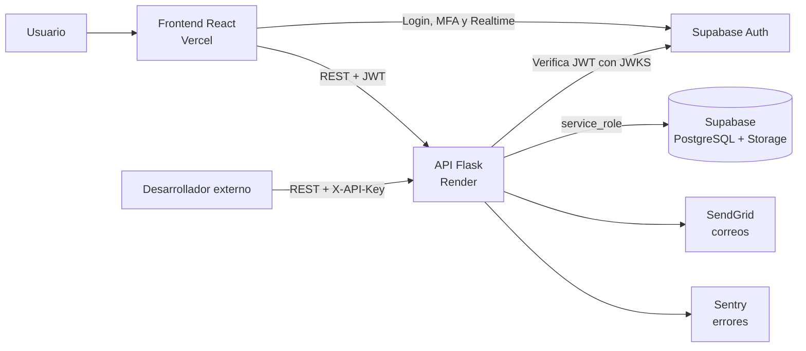

# Huellitas API — Backend

API REST de **Huellitas**, una plataforma de adopción de animales que conecta fundaciones animalistas del Tolima (Colombia) con personas que quieren adoptar. Gestiona usuarios por rol, mascotas, solicitudes de adopción, agendamiento de visitas y una API pública con llaves para desarrolladores externos.


| | |
|---|---|
| **Demo** | [huellitas-frontend-gamma.vercel.app](https://huellitas-frontend-gamma.vercel.app) (cuentas de prueba en el [README del frontend](https://github.com/MurilloR11/huellitas-frontend#probar-la-demo)) |
| **API en producción** | `https://huellitas-backend-7mxy.onrender.com` |
| **Frontend** | [MurilloR11/huellitas-frontend](https://github.com/MurilloR11/huellitas-frontend) (React + TypeScript) |
| **Documentación de la API** | Swagger/OpenAPI en el portal de desarrolladores de la demo |

---

## Contenido

- [Arquitectura](#arquitectura)
- [Stack](#stack)
- [Funcionalidades](#funcionalidades)
- [Estructura del proyecto](#estructura-del-proyecto)
- [Endpoints](#endpoints)
- [Cómo correrlo en local](#cómo-correrlo-en-local)
- [Pruebas](#pruebas)
- [Despliegue](#despliegue)
- [Modo demo](#modo-demo)
- [Limitaciones conocidas](#limitaciones-conocidas)

---

## Arquitectura



- El **frontend** inicia sesión directamente con Supabase Auth y envía el JWT a esta API en el header `Authorization: Bearer <token>`.
- La **API** verifica la firma del token con las llaves públicas (JWKS) de Supabase, consulta el rol del usuario en la tabla `profiles` y aplica los permisos de cada endpoint.
- Todas las escrituras pasan por la API usando la llave `service_role`. Además, la base de datos tiene **políticas RLS** como segunda capa de protección para cualquier acceso directo.

## Stack

| Tecnología | Uso |
|---|---|
| **Python + Flask 3** | API REST organizada por *blueprints* (un módulo por dominio) |
| **Supabase** | PostgreSQL, autenticación (JWT, MFA TOTP), Storage y Realtime |
| **PyJWT** | Verificación de tokens con JWKS (ES256/RS256) |
| **Flask-Limiter** | Límite de peticiones por endpoint |
| **Flask-CORS** | Orígenes permitidos para el frontend |
| **SendGrid** | Correos transaccionales (códigos OTP para recuperar contraseña) |
| **Sentry** | Monitoreo de errores en producción |
| **pytest** | Pruebas unitarias con la base de datos simulada (*mocks*) |
| **Gunicorn + Render** | Servidor y despliegue continuo desde `master` |

## Funcionalidades

**Roles y permisos.** Cuatro roles con permisos distintos: `ciudadano`, `fundacion`, `admin` y `developer`. El rol se asigna al registrarse mediante un *trigger* en la base de datos, que impide que alguien se asigne `admin` a sí mismo.

**Autenticación y seguridad**
- Verificación de JWT de Supabase con JWKS y caché del rol durante 60 segundos.
- Doble factor (MFA con TOTP) y **códigos de respaldo** guardados con *hash*.
- Recuperación de contraseña con código OTP enviado por correo.
- Políticas RLS en PostgreSQL y bloqueo de la autoasignación de roles.
- Límite de peticiones en todos los endpoints (por ejemplo, 60/min en lecturas públicas).

**Adopciones**
- Las fundaciones publican mascotas con fotos (Supabase Storage).
- Los ciudadanos envían solicitudes, suben documentos y agendan visitas según la disponibilidad de la fundación.
- Seguimiento del estado de cada solicitud con un código de rastreo.

**Panel de administración.** Aprobación o rechazo de fundaciones, bloqueo de usuarios, suspensión de mascotas, cancelación de adopciones, estadísticas y registro de actividad.

**API pública para desarrolladores.** Los desarrolladores crean varias **llaves de API** (se guardan con *hash* SHA-256) para consultar mascotas y fundaciones desde sus propias aplicaciones. Cada llamada queda registrada para mostrar estadísticas de uso.

## Estructura del proyecto

```
app/
├── __init__.py            # create_app(): configuración, blueprints, manejo de errores
├── config.py              # Variables de entorno (Config y TestConfig)
├── extensions.py          # Cliente de Supabase, JWKS y rate limiter
├── features/              # Un módulo por dominio
│   ├── admin/             #   routes.py (HTTP) + service.py (lógica y base de datos)
│   ├── adoptions/
│   ├── ai/
│   ├── auth/
│   ├── developer/
│   ├── foundations/
│   └── pets/
└── shared/
    ├── middleware/        # require_auth, require_admin, API keys, registro de llamadas
    └── utils/             # Correos, notificaciones, registro de actividad, logger
migrations/                # Scripts SQL para el SQL Editor de Supabase
tests/                     # Pruebas con pytest
run.py                     # Punto de entrada (gunicorn run:app)
```

Cada módulo separa la capa HTTP (`routes.py`: validación de entrada y códigos de respuesta) de la lógica de negocio (`service.py`: consultas a Supabase).

## Endpoints

Resumen de las rutas principales. **Público** = sin autenticación (algunas aceptan `X-API-Key` opcional para registrar el uso).

| Módulo | Método y ruta | Acceso |
|---|---|---|
| **Mascotas** | `GET /pets`, `GET /pets/<id>`, `GET /pets/by-code/<code>` | Público |
| | `POST /pets`, `POST /pets/<id>/photos` | Fundación |
| **Fundaciones** | `GET /foundations`, `GET /foundations/<id>`, `GET /foundations/<id>/availability` | Público |
| | `GET /foundations/me/pets`, `GET /foundations/me/adoptions`, `POST /foundations/me/availability` | Fundación |
| | `GET /foundations/pending`, `POST /foundations/<id>/approve`, `POST /foundations/<id>/reject` | Admin |
| **Adopciones** | `POST /adoptions`, `GET /adoptions/mine`, `GET /adoptions/<id>` | Autenticado |
| | `POST /adoptions/<id>/documents`, `POST /adoptions/<id>/schedule` | Autenticado |
| | `GET /adoptions/by-code/<code>`, `PATCH /adoptions/<id>/status` | Fundación |
| **Autenticación** | `GET /auth/me`, códigos de respaldo, llave de acceso, factor MFA | Autenticado |
| | `POST /auth/forgot-password`, `POST /auth/verify-otp`, `POST /auth/reset-password` | Público |
| **Developer** | `GET/POST /developer/keys`, `DELETE /developer/keys/<id>`, `GET /developer/stats` | Autenticado |
| **Admin** | `GET /admin/stats`, `/users`, `/foundations`, `/pets`, `/adoptions`, `/activities` | Admin |
| | `POST /admin/users/<id>/ban`, `/unban`, `/pets/<id>/suspend`, `/unsuspend`, `/adoptions/<id>/cancel` | Admin |

Ejemplo de consulta pública:

```bash
curl "https://huellitas-backend-7mxy.onrender.com/pets?species=dog&per_page=5"
```

## Cómo correrlo en local

### Requisitos

- Python 3.10 o superior
- Un proyecto de [Supabase](https://supabase.com) (el plan gratuito sirve)
- Una llave de API de [SendGrid](https://sendgrid.com) (solo para los correos de recuperación de contraseña)

### 1. Instalar dependencias

```bash
git clone https://github.com/MurilloR11/huellitas-backend.git
cd huellitas-backend
python -m venv .venv
source .venv/bin/activate        # En Windows: .venv\Scripts\activate
pip install -r requirements.txt
```

### 2. Configurar variables de entorno

```bash
cp .env.example .env
```

| Variable | Obligatoria | Descripción |
|---|---|---|
| `SUPABASE_URL` | Sí | URL del proyecto (Settings → API) |
| `SUPABASE_SERVICE_ROLE_KEY` | Sí | Llave `service_role`. **Nunca** debe llegar al frontend |
| `SUPABASE_JWT_SECRET` | Sí | JWT Secret del proyecto (Settings → API) |
| `SENDGRID_API_KEY` | Sí | Llave de SendGrid para enviar correos |
| `EMAIL_FROM` | No | Remitente de los correos |
| `FRONTEND_URL` | No | URL del frontend; también se usa como origen permitido en CORS |
| `CORS_ORIGINS` | No | Orígenes extra permitidos, separados por coma |
| `RATELIMIT_STORAGE_URI` | No | `memory://` por defecto; Redis si hay varios workers |
| `SENTRY_DSN` | No | Activa el monitoreo de errores |
| `DEMO_USER_IDS` | No | UUID de las cuentas de demo de solo lectura (ver [Modo demo](#modo-demo)) |
| `FLASK_DEBUG` | No | `true` solo en desarrollo |

### 3. Preparar la base de datos

Ejecuta los scripts de `migrations/` en el **SQL Editor** de Supabase, en este orden:

1. `supabase_setup.sql`: tipos, tablas base (`profiles`, `foundations`, `developers`), *trigger* de registro y RLS
2. `rls_policies.sql`
3. `add_pets_adoptions_schedules.sql`
4. `add_adoption_form_data.sql`
5. `create_adoption_documents_bucket.sql`
6. `add_foundation_availability.sql`
7. `add_activity_logs.sql`
8. `add_developer_multikey.sql`
9. `add_api_key_hash_index.sql`
10. `add_api_call_logs.sql`
11. `add_demo_accounts.sql`

### 4. Ejecutar

```bash
flask --app run run --debug      # http://localhost:5000
```

## Pruebas

```bash
pytest -q
```

Las pruebas no necesitan una base de datos real: simulan el cliente de Supabase con `unittest.mock` y firman tokens de prueba con HS256. Cubren:

- `tests/test_foundations.py`: validación de tokens (expirado, firma incorrecta, sin `Bearer`), permisos de admin y revisión de fundaciones pendientes.
- `tests/test_demo_mode.py`: bloqueo de escrituras para las cuentas demo, correos enmascarados y que los usuarios reales no se vean afectados.

## Despliegue

El backend está desplegado en **Render** (plan gratuito) con despliegue automático en cada *push* a `master`:

```
web: gunicorn run:app
```

Las variables de entorno se configuran en Render → Environment. El workflow [`keep-alive.yml`](.github/workflows/keep-alive.yml) consulta la API cada 3 días para que el proyecto de Supabase no se pause por inactividad.

## Modo demo

Las credenciales de la demo son públicas, así que esas cuentas tienen protección en dos capas:

1. **API:** si el usuario está en `DEMO_USER_IDS`, cualquier `POST`, `PATCH` o `DELETE` responde `403 Modo demo: esta cuenta es de solo lectura`. En el panel admin, los correos de los usuarios reales aparecen enmascarados (`a***@gmail.com`).
2. **Base de datos:** la migración `add_demo_accounts.sql` hace que la cuenta admin de demo no obtenga el rol `admin` en las políticas RLS, así que tampoco puede leer datos de otros usuarios con su token directamente contra Supabase.

## Limitaciones conocidas

- **Chat con IA (`/ai/chat`):** usa un modelo local con [Ollama](https://ollama.com) en `localhost:11434`, así que solo funciona en desarrollo, no en el despliegue.
- **Migraciones incompletas:** las tablas `access_keys`, `backup_codes`, `notifications` y `otp_store` se crearon desde el SQL Editor de Supabase y todavía no tienen su script en `migrations/`.
- **Arranque en frío:** en el plan gratuito de Render, la primera petición después de un rato sin uso puede tardar unos 50 segundos.

---

Desarrollado por **Santiago Murillo Montealegre** como proyecto de grado de Tecnología en Gestión Informática (UniEspinal, 2026).
[GitHub](https://github.com/MurilloR11) · [LinkedIn](https://linkedin.com/in/santiago-murillo-99137a297)
